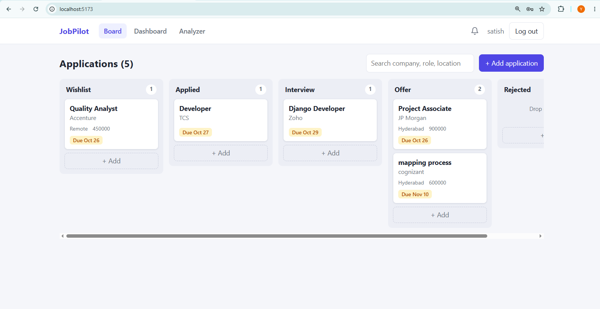
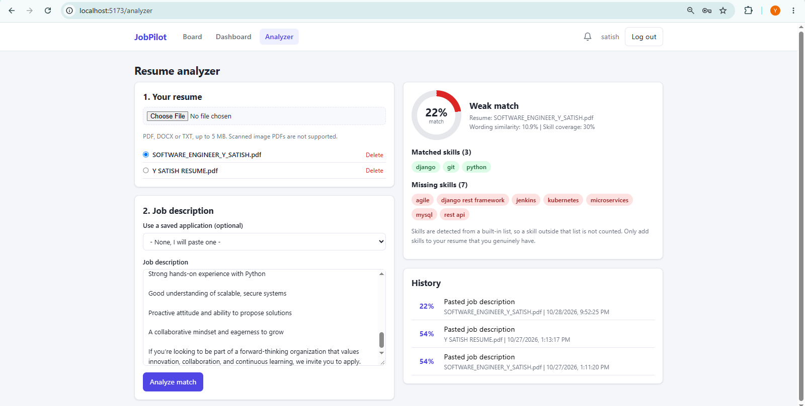
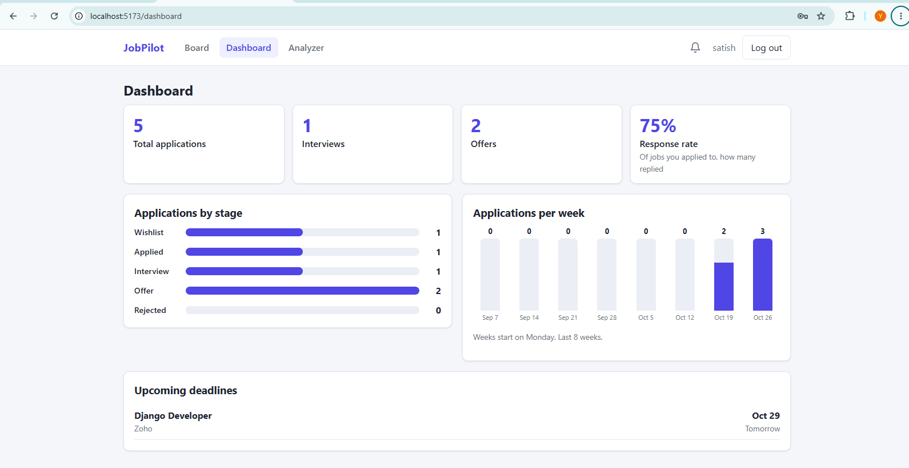

# JobPilot

Track job applications on a Kanban board and check how well your resume matches a job description.

**Demo video:** [Watch the walkthrough]([https://drive.google.com/file/d/1FxbPlPfp5fgOA4Lt7ChHRxr5zwC9WOyy/view?usp=sharing])

| REgister and Login |


|Kanban board |



| Resume analyzer |

 

| Dashboard |

 |

|Add application |


| Notification |


## Features
- Register and log in (token authentication); each user only sees their own data
- Kanban board with drag and drop, add, edit and delete, search, and a status history timeline
- Resume analyzer: upload a PDF, DOCX or TXT resume and get a match score with matched and missing skills (TF-IDF, cosine similarity and skill extraction with scikit-learn)
- Dashboard: counts per stage, response rate, applications per week, upcoming deadlines
- Notification bell with deadline reminders, updated by REST polling

## Tech stack
React (Vite), React Router, Axios, plain CSS | Django, Django REST Framework, SQLite, scikit-learn, pypdf, python-docx

## How the analyzer works
1. Extract text from the resume (pypdf, python-docx).
2. Compute TF-IDF vectors of the resume and job description and their cosine similarity.
3. Extract skills from both texts using a curated skill list and regex matching with word boundaries.
4. Final score = 40% wording similarity + 60% skill coverage. The weights are tunable heuristics.

## Run locally

**Backend** (Python 3.12+)
```bash
cd backend/config
python -m venv ../.venv
../.venv/Scripts/activate        # Windows
pip install -r requirements.txt
python manage.py migrate
python manage.py test            # run the automated tests
python manage.py runserver
```

**Frontend** (Node 20+), in a second terminal
```bash
cd frontend
npm install
echo VITE_API_URL=http://127.0.0.1:8000/api > .env
npm run dev
```
Open http://localhost:5173 and register an account.

## API
All endpoints except register and login need the header `Authorization: Token <token>`.

| Area | Endpoints |
|---|---|
| Auth | `/api/auth/register/`, `/login/`, `/logout/`, `/me/` |
| Applications | `/api/applications/` (filter, search, pagination) |
| Resumes and analysis | `/api/resumes/`, `/api/analyze/`, `/api/analyses/` |
| Notifications | `/api/notifications/`, `/unread-count/`, `/read-all/` |
| Dashboard | `/api/dashboard/stats/` |

## Limitations and next steps
- SQLite is used for simplicity; PostgreSQL would be the production choice.
- Notifications use polling; WebSockets (Django Channels) would make them instant.
- Skill detection uses a built-in list; semantic matching with embeddings is a possible upgrade.